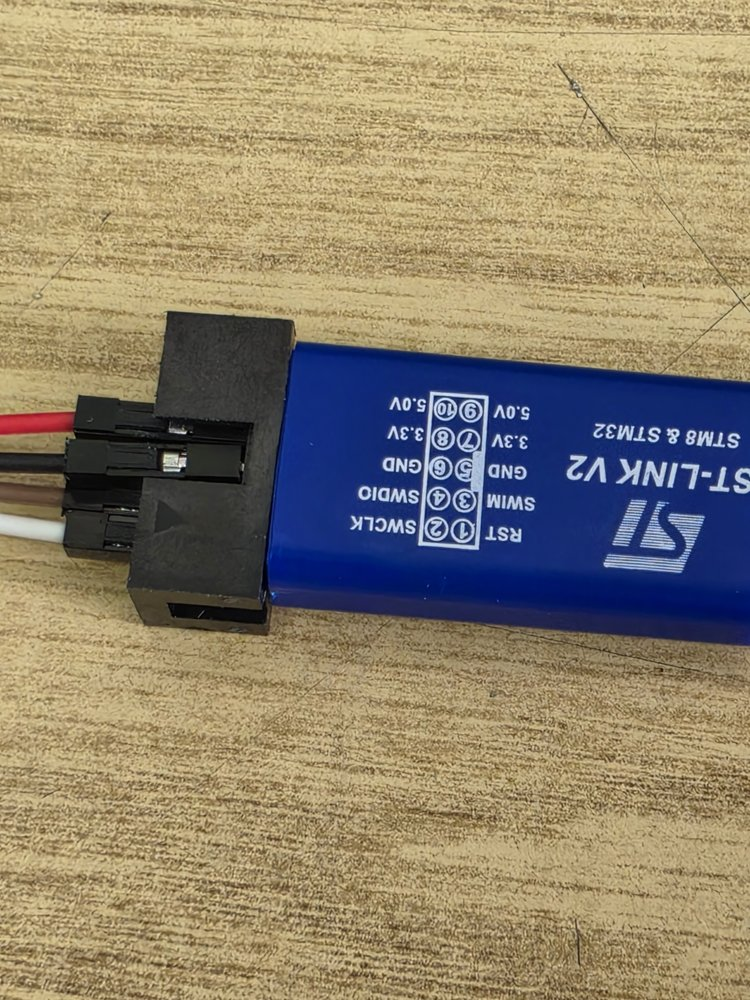
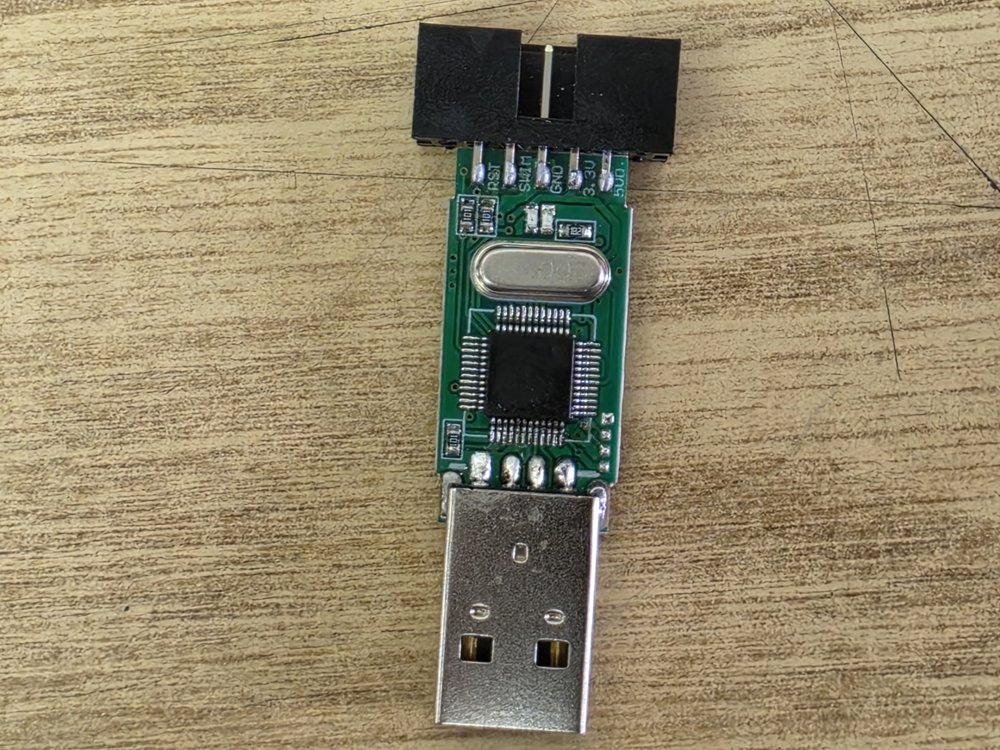
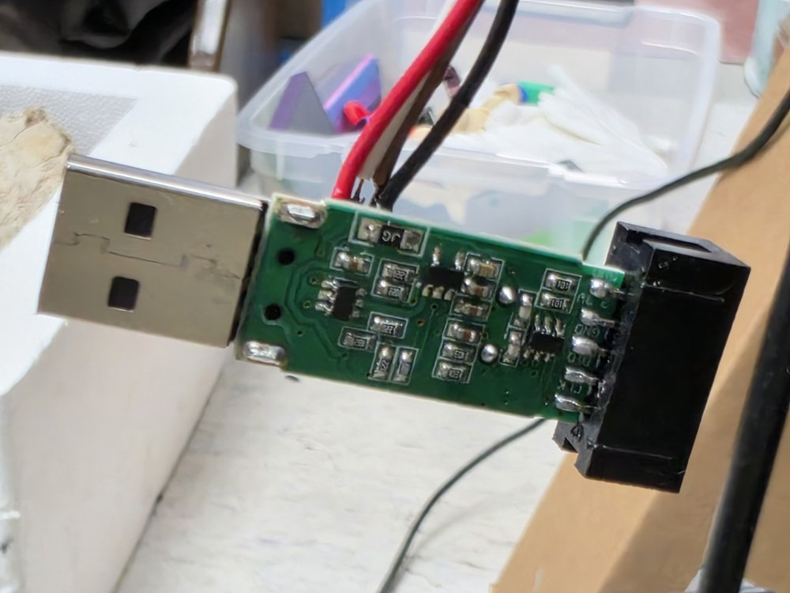
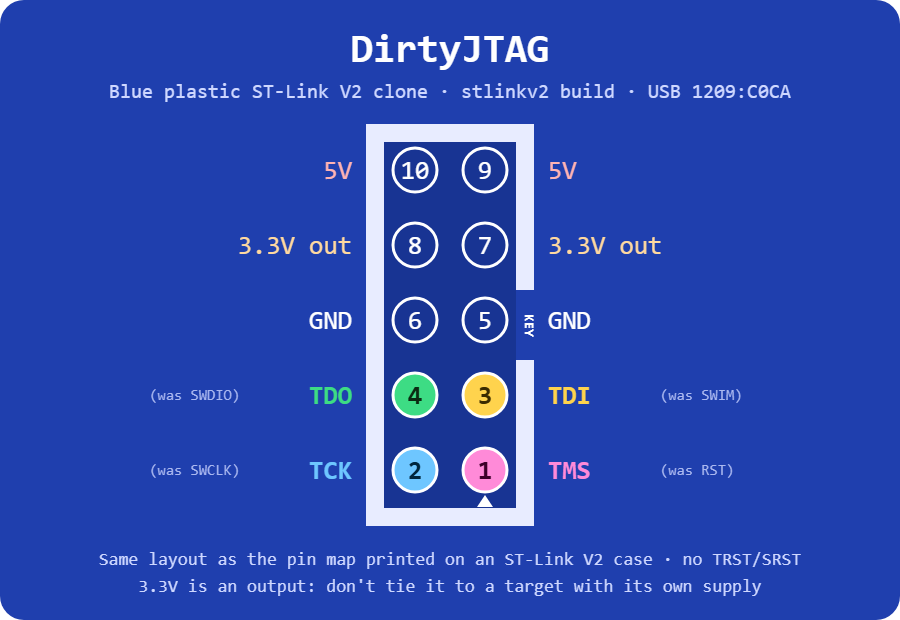

# Installing DirtyJTAG on a blue plastic ST-Link v2 clone

These clones come in a blue plastic case with the pin map printed on top. Inside is a green PCB with an STM32F103 (128 KiB flash, chip ID `0x410`) and a shrouded 2x5 header whose pins are labelled on the silkscreen. They look different from the [aluminium dongle](install-stlinkv2-swd.md), but the header signals are wired to the same MCU pins, so the regular **`stlinkv2`** build works.



Note that the 10-pin header is in a **different order** from the aluminium dongle, so the physical DirtyJTAG pinout differs too. Use the [pinout below](#pinout), not the one for the aluminium dongle.

## Prerequisites

 * A second ST-Link (or any SWD programmer)
 * 4 jumper wires, or thin wire to solder to the SWD pads
 * [stlink](https://github.com/stlink-org/stlink) (`st-flash`)
 * [OpenOCD](http://openocd.org)

## Opening the case and finding the SWD pads

Take the PCB out of the plastic case. The MCU's SWD port is on a column of 4 small square pads next to the MCU, on the USB connector side:





The pads are not labelled. Identify them with a continuity tester:

1. **GND** beeps to the USB connector shell
2. **3V3** beeps to the `3.3V` pin of the 2x5 header
3. **SWDIO** goes to MCU pin 34 (PA13), **SWCLK** to MCU pin 37 (PA14)

If you skip step 3, swapping SWDIO and SWCLK is harmless: the programmer just won't see the chip (`Failed to enter SWD mode`) until they are the right way round.

Connect the pads to the programmer's SWDIO, SWCLK, GND and 3.3V. Do not plug the target into USB while flashing.

Do **not** wire the programmer to the target's 2x5 header: those pins are the clone's outputs, not its own SWD port.

## Remove flash protection

The factory firmware is read-protected. `st-info --probe` will find the chip, but reading the flash returns garbage. Unlock it with OpenOCD (this erases the whole flash):

```
openocd -f interface/stlink.cfg -f target/stm32f1x.cfg -c "init; reset halt; stm32f1x unlock 0; reset halt; shutdown"
```

See [the flash protection page](stm32f1-flash-protection.md) for details and for clone MCUs with a different idcode.

## Flashing DirtyJTAG

```
st-flash write dirtyjtag.stlinkv2.noloader.bin 0x8000000
```

Unplug the programmer, plug the clone in on its own, and it should enumerate as `1209:C0CA`.

## Pinout



Measured mapping between the header and the MCU (several header pins are tied to more than one GPIO):

| Header label | MCU pins   | DirtyJTAG signal |
|--------------|------------|------------------|
| RST          | PB5, PB6   | TMS (PB6)        |
| SWIM         | PB7–PB11   | TDI (PB8)        |
| SWCLK        | PA5, PB13  | TCK (PA5)        |
| SWDIO        | PB12, PB14 | TDO (PB14)       |

As with the other ST-Link targets, there is no TRST or SRST.
